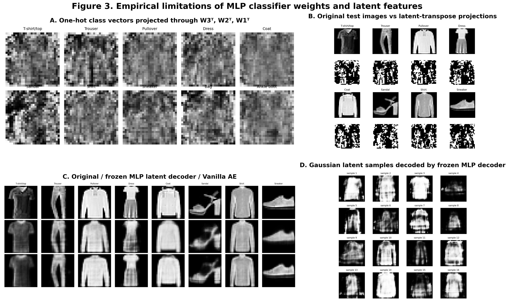
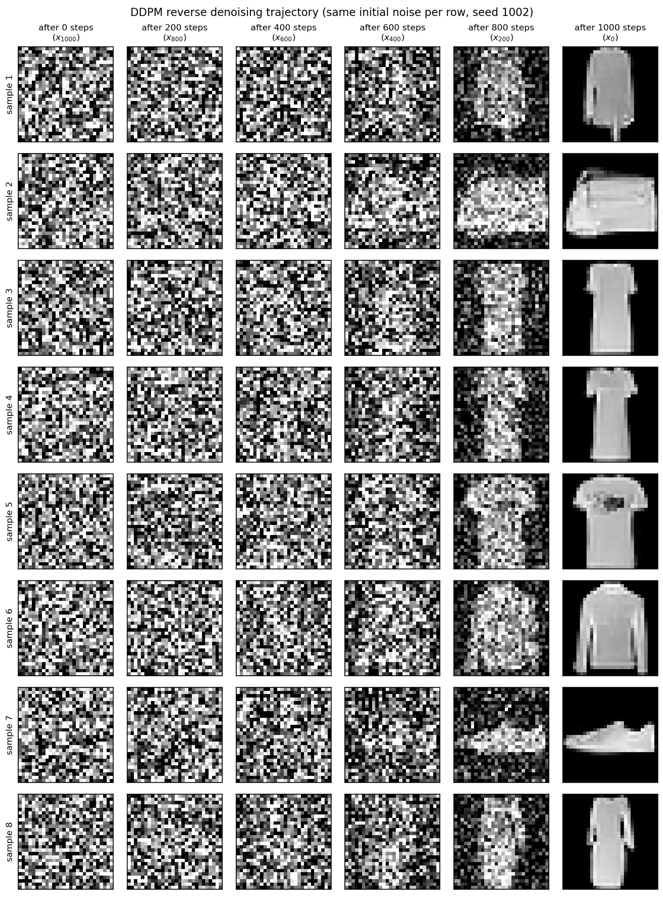

# Comparative Study of Generative Models on Fashion-MNIST

This project compares six generative models using Fashion-MNIST. I also built an MLP classifier experiment to test whether a model trained for classification can be used to reconstruct or generate images.

The experiments look at reconstruction quality, generated samples, latent space, training behaviour, and inference time.

**Repository:** https://github.com/champsand/generative-model-comparison-dl  
**Environment used for the recorded runs:** Google Colab, NVIDIA Tesla T4

## 1. Experiments

There are seven notebooks in this project.

| ID | Notebook | Main purpose |
|---|---|---|
| 01 | `01_vanilla_ae.ipynb` | Image reconstruction with a Vanilla Autoencoder |
| 02 | `02_sparse_ae.ipynb` | Reconstruction with an L1 sparsity penalty |
| 03 | `03_vanilla_gan.ipynb` | Image generation with a fully connected GAN |
| 04 | `04_vae.ipynb` | Probabilistic latent representation and image generation |
| 05 | `05_dcgan.ipynb` | Image generation with a convolutional GAN |
| 06 | `06_ddpm.ipynb` | Image generation through iterative denoising |
| 07 | `07_mlp_classifier.ipynb` | Classification and experiments on the limits of classifier features for image generation |

The first six notebooks are the generative-model experiments. The MLP classifier is a separate experiment required by the assignment.

## 2. Dataset

All experiments use Fashion-MNIST (28 x 28 grayscale images, 10 classes).

The 60,000 images from the official training partition and the 10,000 images from the official test partition were pooled first. I then used a class-stratified split with random seed 42.

| Split | Number of images | Images per class |
|---|---:|---:|
| Train | 56,000 | 5,600 |
| Validation | 7,000 | 700 |
| Test | 7,000 | 700 |
| **Total** | **70,000** | **7,000** |

The split reports contain SHA-256 hashes for the train, validation, and test indices. The hashes match across all seven experiments.

**Dataset note:** because the official train and test partitions were pooled before splitting, the original 10,000-image official test partition is not kept as a separate test set. The results in this repository use the project's 7,000-image held-out stratified test split.

The normal image range is `[0, 1]`. The GAN, DCGAN, and DDPM notebooks convert images to `[-1, 1]` for their model inputs where required.

## 3. Model setup

The main configurations are saved in `configs/`. Each experiment also saves its resolved configuration beside its metrics.

| Model | Latent size / state | Main objective | Epochs |
|---|---:|---|---:|
| Vanilla AE | 64 | MSE | 30 |
| Sparse AE | 64 | MSE + L1 latent penalty (`lambda = 0.001`) | 30 |
| Vanilla GAN | 100 | Adversarial BCE objective | 30 |
| VAE | 64 | Reconstruction loss + KL divergence (`beta = 1`) | 30 |
| DCGAN | 100 | Adversarial BCE-with-logits objective | 30 |
| DDPM | 28 x 28 image state, `T = 1,000` | Noise-prediction MSE | 30 |
| MLP classifier | 64-dimensional hidden representation | Cross-entropy | 40 classifier + 30 decoder |

The default training batch size is 128. The notebooks use a fixed seed for the shared split and record their additional sampling seeds in the saved configurations.

## 4. Results

The tables below summarise the values saved in `results/metrics/`. The JSON files contain the full-precision values and additional run details.

### Reconstruction and generation quality

| Model | Test MSE | Test PSNR (dB) | Test SSIM | Test FID |
|---|---:|---:|---:|---:|
| Vanilla AE | 0.008073 | 20.930 | 0.7452 | N/A |
| Sparse AE | 0.008382 | 20.767 | 0.7405 | N/A |
| Vanilla GAN | N/A | N/A | N/A | 149.307 |
| VAE | 0.017124 | 17.664 | 0.5825 | 89.461 |
| DCGAN | N/A | N/A | N/A | 22.957 |
| DDPM | N/A | N/A | N/A | 20.748 |

MSE, PSNR, and SSIM are used for models that reconstruct a given input. FID is used for the models that generate new samples. `N/A` means that the metric does not apply to that model; it does not mean the score was zero.

### Training time and inference latency

| Model | Mean epoch wall time (s) | Inference latency (ms / batch of 64) | Trainable parameters | Best epoch |
|---|---:|---:|---:|---:|
| Vanilla AE | 8.167 | 0.244 | 435,536 | 30 |
| Sparse AE | 7.990 | 0.231 | 435,536 | 30 |
| Vanilla GAN | 9.208 | 0.383 | 1,093,137 | 30 |
| VAE | 14.530 | 0.208 | 451,984 | 30 |
| DCGAN | 17.659 | 3.427 | 898,305 | 30 |
| DDPM | 42.713 | 15,985.153 | 2,863,393 | 29 |

All latency values were recorded on a Tesla T4 GPU. The operation being timed depends on the model:

- Vanilla AE and Sparse AE: encoder plus decoder.
- VAE: prior sampling plus decoder.
- Vanilla GAN and DCGAN: generator forward pass.
- DDPM: the full 1,000-step reverse denoising process.

DDPM latency is therefore not the same kind of operation as a single generator pass. Its measurement used one warm-up and three timed runs; most other model measurements used 20 warm-ups and 100 timed runs. Check the model-specific JSON files for the exact timing details.

Epoch wall time also includes different work for different models, such as validation FID for the GAN experiments. It should be read together with the timing definitions in each metrics file.

### MLP classifier experiment

The MLP classifier uses the architecture `784 -> 256 -> 64 -> 10`.

| Measurement | Result |
|---|---:|
| Classifier test accuracy | 89.86% |
| Required accuracy | 88% |
| Frozen latent decoder test MSE | 0.018038 |
| Frozen latent decoder test PSNR | 17.438 dB |
| Frozen latent decoder test SSIM | 0.5962 |
| Direct latent-transpose projection MSE | 0.314733 |
| Direct latent-transpose projection PSNR | 5.021 dB |
| Direct latent-transpose projection SSIM | 0.0490 |

The frozen decoder is trained separately while the classifier is kept frozen. These reconstruction metrics belong to that decoder, not to the classifier accuracy.

## 5. Comparative figures

The comparative figures are in `results/figures/comparative/`.

### Figure 1 - Reconstruction comparison

Eight held-out test images are shown with their Vanilla AE, Sparse AE, and VAE reconstructions.


### Figure 2 - Random generative samples

Each model has a 4 x 4 grid of samples: VAE, Vanilla GAN, DCGAN, and DDPM.


### Figure 3 - MLP classifier limitations

This figure contains the class-vector transpose projection, test-image latent transpose projection, frozen-decoder comparison, and Gaussian latent samples.



### Figure 4 - Latent interpolation

The figure compares six interpolation points (`alpha = 0.0, 0.2, 0.4, 0.6, 0.8, 1.0`) across five models. Vanilla GAN and DCGAN do not have encoders, so their endpoints were obtained through approximate latent inversion.


### Figure 5 - Training curves and DDPM denoising

Figure 5 is saved as two files: the training and validation curves, followed by the DDPM reverse trajectory.




Per-model figures are also saved under `results/figures/per_model/`.

## 6. Evaluation notes

### Reconstruction metrics

- **MSE** measures the average squared pixel difference.
- **PSNR** is calculated from the aggregate test MSE using a data range of 1.0.
- **SSIM** is the average of the per-image SSIM scores. The saved runs use `skimage.metrics.structural_similarity` with `data_range=1.0`, Gaussian weights, `sigma=1.5`, `win_size=11`, and `use_sample_covariance=False`.

### FID

FID uses `pytorch-fid==0.3.0` and InceptionV3 pool3 features (2,048 dimensions). The evaluation uses 7,000 held-out real images and 7,000 generated images. Grayscale images are repeated across three channels and resized to 299 x 299 for the feature extractor.

InceptionV3 was trained on ImageNet natural images, not Fashion-MNIST. I use these FID values to compare the models under the same project setup. They should not be treated as an absolute measure of image quality or compared directly with FID values from unrelated datasets.

### Training behaviour

The AE and VAE objectives decrease during training. GAN losses are adversarial, so their curves do not behave like a standard reconstruction loss. The DDPM noise-prediction objective decreases over the training run. The histories in `results/metrics/` can be used to inspect each epoch.

## 7. Repository layout

```text
generative-model-comparison-dl/
├── README.md
├── AI_ASSISTANCE.md
├── requirements.txt
├── LICENSE
├── .gitignore
├── configs/                  # JSON settings for the seven experiments
├── notebooks/                # Seven Colab notebooks
└── results/
    ├── metrics/               # Metrics, split reports, configs, and CSV histories
    └── figures/
        ├── per_model/         # Figures from each experiment
        └── comparative/       # Figures 1-5
```

The notebooks are currently self-contained. A separate reusable `src/` package has not yet been added. This is the main code-organization item still to complete for the modular PyTorch requirement in the assignment.

Large checkpoints and the downloaded dataset are kept in Google Drive, not in this repository. The notebooks save their experiment outputs under:

`/content/drive/MyDrive/generative-model-comparison/`

## 8. Running the notebooks

The experiments were run in Google Colab. A GPU runtime is recommended, especially for DCGAN and DDPM.

1. Open the repository on GitHub.
2. Open a notebook in `notebooks/` and choose **Open in Colab**.
3. Select a GPU runtime.
4. Install the dependencies in `requirements.txt` if needed.
5. Run the notebook cells from top to bottom.
6. When prompted, mount Google Drive. The notebooks save checkpoints and experiment outputs there.

The requirements file does not pin PyTorch or torchvision because the recorded runs used the builds supplied by the Colab runtime. Do not blindly upgrade those packages in Colab; they need to be compatible with each other and with the CUDA runtime.

The saved metrics and figures in this repository are provided for review. Running all training cells again will repeat the experiments and use GPU time.

## 9. Reproducibility and saved results

The repository contains:

- Seven experiment notebooks.
- One JSON configuration for each experiment.
- Metrics JSON files and split reports.
- Training-history CSV files.
- Per-model figures and the comparative figures.
- The shared split seed and SHA-256 hashes.

The `.pth` checkpoints, Fashion-MNIST cache, and large intermediate files are kept in Google Drive. They are not committed to GitHub.

## 10. AI assistance

Claude and ChatGPT were used as support during brainstorming and notebook code development. More detail is in [AI_ASSISTANCE.md](AI_ASSISTANCE.md). The training runs and the saved experiment results were produced by the student.

## References

- Fashion-MNIST: https://github.com/zalandoresearch/fashion-mnist
- PyTorch: https://pytorch.org/
- Torchvision datasets: https://pytorch.org/vision/stable/datasets.html
- PyTorch FID: https://github.com/mseitzer/pytorch-fid
- scikit-image SSIM: https://scikit-image.org/docs/stable/api/skimage.metrics.html#skimage.metrics.structural_similarity

## License

See [LICENSE](LICENSE).
