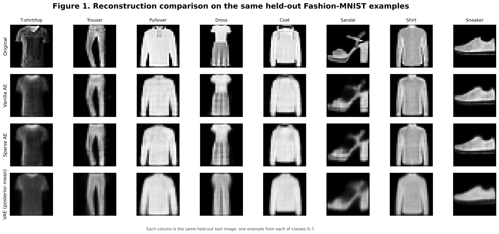
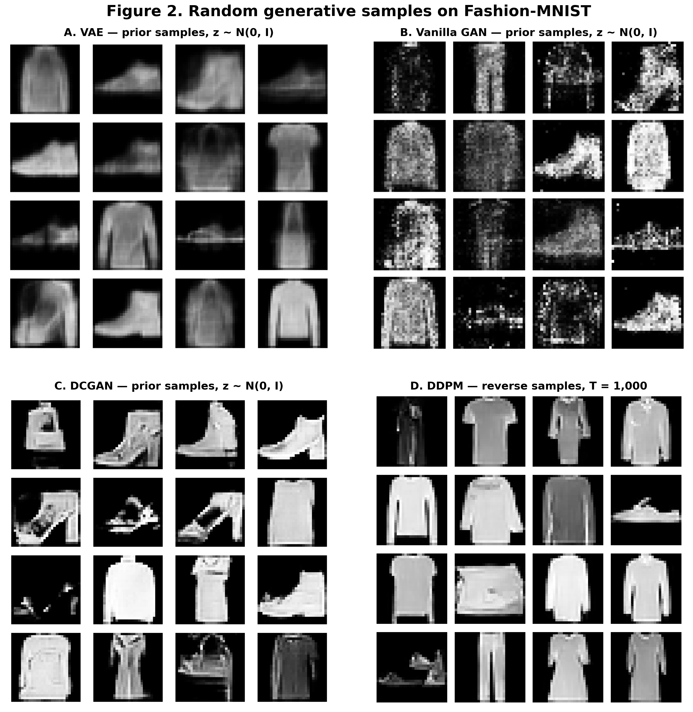
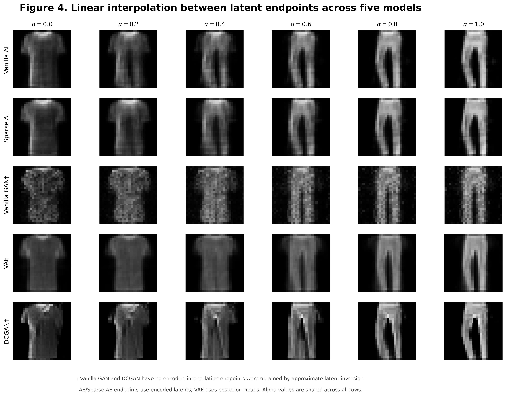
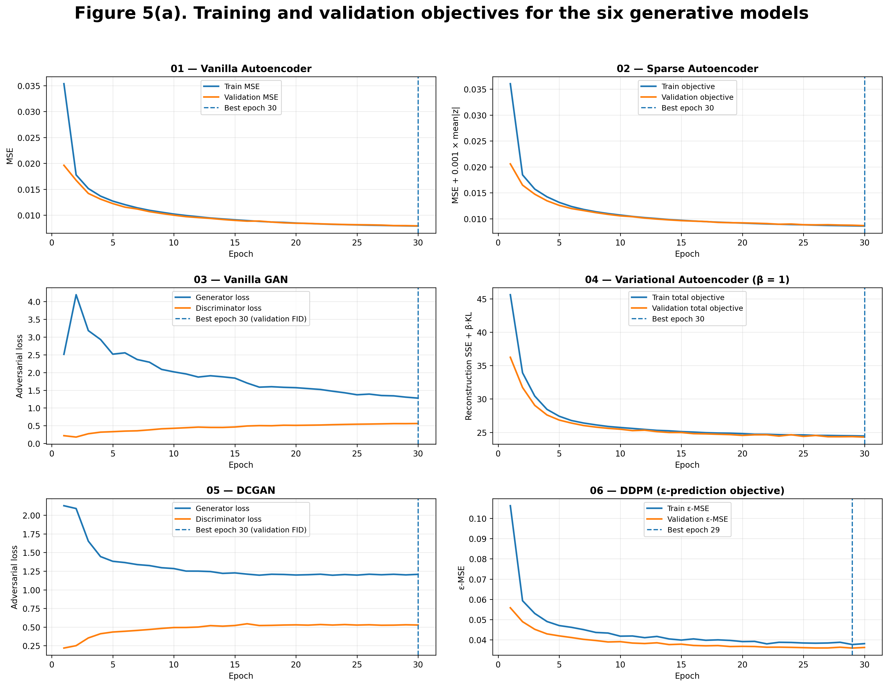

# Comparative Study of Generative Models on Fashion-MNIST

This project compares six generative models using Fashion-MNIST. I also include an MLP classifier experiment to study why a classifier trained to predict labels is not automatically suitable for reconstructing or generating images.

The experiments look at reconstruction quality, generated samples, latent-space behaviour, training behaviour, and inference time.

**Repository:** https://github.com/champsand/generative-model-comparison-dl  
**Experiment environment:** Google Colab, NVIDIA Tesla T4

## 1. Experiments

There are seven experiment notebooks in this repository.

| ID | Model | Main purpose |
|---|---|---|
| 01 | Vanilla Autoencoder | Deterministic image reconstruction |
| 02 | Sparse Autoencoder | Reconstruction with an L1 latent-activation penalty |
| 03 | Vanilla GAN | Fully connected adversarial image generation |
| 04 | Variational Autoencoder (VAE) | Probabilistic latent representation and image generation |
| 05 | DCGAN | Convolutional adversarial image generation |
| 06 | DDPM | Image generation through iterative denoising |
| 07 | MLP Classifier | Classification and experiments on the limits of classifier features for image generation |

The first six notebooks are the generative-model experiments. Model 07 is a separate classifier experiment and is not included as a seventh model in the generative FID comparison.

## 2. Dataset and split

All experiments use Fashion-MNIST (28 x 28 grayscale images, 10 classes).

The official training partition (60,000 images) and official test partition (10,000 images) were pooled, in that order, into one 70,000-image dataset. A class-stratified split was then created using random seed 42.

| Split | Number of images | Images per class |
|---|---:|---:|
| Train | 56,000 | 5,600 |
| Validation | 7,000 | 700 |
| Test | 7,000 | 700 |
| **Total** | **70,000** | **7,000** |

The split reports store SHA-256 hashes for the train, validation, and test indices. These hashes match across all seven experiments.

**Dataset note:** because the official partitions were pooled before splitting, the original 10,000-image official test partition is not kept as a separate test set. The results in this repository use the project's held-out 7,000-image stratified test split.

The normal image range is `[0, 1]`. Vanilla GAN, DCGAN, and DDPM convert images to `[-1, 1]` for their model computations.

## 3. Model configurations

The JSON files in `configs/` record the experiment settings. Each model also has its resolved configuration saved with its metrics.

| Model | Architecture / latent size | Main objective | Training epochs |
|---|---|---|---:|
| Vanilla AE | 784 → 256 → 64 → 256 → 784 | MSE | 30 |
| Sparse AE | Same 64-dimensional AE backbone | MSE + 0.001 × mean(abs(latent)) | 30 |
| Vanilla GAN | G: 100 → 256 → 512 → 784 | Adversarial BCE | 30 |
| VAE | 784 → 256 → (mu, logvar), latent 64 | Reconstruction SSE + KL, beta = 1 | 30 |
| DCGAN | Convolutional generator, latent 100 | BCEWithLogits adversarial objective | 30 |
| DDPM | Time-conditioned U-Net, T = 1,000 | Epsilon-prediction MSE | 30 |
| MLP Classifier | 784 → 256 → 64 → 10 | Cross-entropy | 40 classifier + 30 decoder |

The default training batch size is 128. Exact settings, seeds, and evaluation details are saved in the configuration and metrics files.

## 4. Results

The values below are taken from `results/metrics/master_comparison_table.csv` and the individual experiment metrics. The CSV keeps full precision; values are rounded here for readability.

### Reconstruction and generation metrics

| Model | Test MSE | Test PSNR (dB) | Test SSIM | Test FID |
|---|---:|---:|---:|---:|
| Vanilla AE | 0.008073 | 20.930 | 0.7452 | N/A |
| Sparse AE | 0.008382 | 20.767 | 0.7405 | N/A |
| Vanilla GAN | N/A | N/A | N/A | 149.307 |
| VAE | 0.017124 | 17.664 | 0.5825 | 89.461 |
| DCGAN | N/A | N/A | N/A | 22.957 |
| DDPM | N/A | N/A | N/A | 20.748 |

MSE, PSNR, and SSIM are reported for models with an input-reconstruction path. FID is reported for models that generate new samples. `N/A` means the metric does not apply to that model; it does not mean the score was zero.

### Training time and inference latency

| Model | Mean epoch wall time (s) | Latency (ms / batch of 64) | Trainable parameters | Best epoch |
|---|---:|---:|---:|---:|
| Vanilla AE | 8.167 | 0.244 | 435,536 | 30 |
| Sparse AE | 7.990 | 0.231 | 435,536 | 30 |
| Vanilla GAN | 9.208 | 0.383 | 1,093,137 | 30 |
| VAE | 14.530 | 0.208 | 451,984 | 30 |
| DCGAN | 17.659 | 3.427 | 898,305 | 30 |
| DDPM | 42.713 | 15,985.153 | 2,863,393 | 29 |

The latency measurements were recorded on an NVIDIA Tesla T4 GPU. The operation being timed differs by model:

- Vanilla AE and Sparse AE: encoder plus decoder forward pass.
- VAE: prior sampling plus decoder forward pass.
- Vanilla GAN and DCGAN: generator forward pass.
- DDPM: the complete 1,000-step reverse denoising process, from noise to an image.

DDPM latency is not equivalent to a single generator forward pass. Its measurement used one warm-up and three timed runs; the other model measurements generally used 20 warm-ups and 100 timed runs. The exact timing details are recorded in the model-specific metrics.

Epoch wall time also includes different work depending on the notebook, such as validation FID for adversarial models. The timing definitions in the JSON files should be checked when interpreting the values.

### MLP classifier experiment

The MLP classifier uses the architecture `784 -> 256 -> 64 -> 10` and reached **89.86% test accuracy**, above the assignment target of 88%.

The separately trained frozen latent decoder achieved:

| Metric | Result |
|---|---:|
| Test MSE | 0.018038 |
| Test PSNR | 17.438 dB |
| Test SSIM | 0.5962 |

The direct latent-transpose projection had MSE 0.314733, PSNR 5.021 dB, and SSIM 0.0490. These reconstruction metrics belong to the projection and decoder experiments, not to classifier accuracy.

Full Model 07 results are saved in `results/metrics/model_07_mlp_classifier/metrics.json`.

## 5. Comparative figures

The combined figures are saved in `results/figures/comparative/`.

### Figure 1 - Reconstruction comparison

Eight held-out test images are shown with their Vanilla AE, Sparse AE, and VAE reconstructions.



### Figure 2 - Random generative samples

Four 4 x 4 sample panels are shown for VAE, Vanilla GAN, DCGAN, and DDPM.



### Figure 3 - MLP classifier limitations

The figure shows class-vector transpose projections, test-image latent transpose projections, the frozen-decoder comparison, and Gaussian latent samples.


### Figure 4 - Latent interpolation

The figure compares six interpolation points (`alpha = 0.0, 0.2, 0.4, 0.6, 0.8, 1.0`) across five models. Vanilla GAN and DCGAN do not have encoders, so their interpolation endpoints were obtained through approximate latent inversion.



### Figure 5 - Training curves and DDPM denoising

Figure 5 is stored in two files: the training and validation curves, followed by the DDPM reverse denoising trajectory.




Original per-model figures are also stored under `results/figures/per_model/`.

## 6. Evaluation notes

### Reconstruction metrics

- **MSE** is the global mean squared pixel error over the test split.
- **PSNR** is calculated from aggregate test MSE using a data range of 1.0.
- **SSIM** is the arithmetic mean of per-image SSIM scores. The saved experiments use `skimage.metrics.structural_similarity` with `data_range=1.0`, Gaussian weights, `sigma=1.5`, `win_size=11`, and `use_sample_covariance=False`.

### FID

FID uses `pytorch-fid==0.3.0` and InceptionV3 pool3 features (2,048 dimensions). The protocol compares 7,000 held-out real test images with 7,000 generated images. Grayscale images are repeated across three channels and resized to 299 x 299 for the feature extractor.

InceptionV3 was pretrained on ImageNet natural images, not Fashion-MNIST. These FID values are used for a relative comparison under this project's shared setup. They should not be treated as absolute image-quality scores or compared directly with results from unrelated datasets.

### Training behaviour

Training histories are saved as CSV files under each model's metrics folder. They contain the objective values and timing information recorded during each run. GAN objectives are adversarial and do not behave like a standard reconstruction loss. The DDPM objective measures noise prediction.

## 7. Repository structure

```text
generative-model-comparison-dl/
├── LICENSE
├── .gitignore
├── configs/                  # JSON configurations for the seven experiments
├── notebooks/                # Seven self-contained Google Colab notebooks
├── src/                      # Reusable PyTorch model and experiment components
│   ├── data/
│   ├── models/
│   ├── training/
│   ├── evaluation/
│   └── utils/
├── tests/                    # CPU smoke checks for source modules
└── results/
    ├── metrics/              # Metrics, split reports, histories, master CSV
    └── figures/
        ├── per_model/
        └── comparative/
```

The notebooks are the records of the completed Colab experiments. The `src/` package contains reusable model definitions, dataset utilities, loss functions, one-batch training helpers, and evaluation utilities.

The notebooks are still self-contained; they have not yet been refactored to import every component from `src/`. The source package complements the notebooks and does not replace the recorded runs.

## 8. Running the notebooks

The experiments were run in Google Colab. A GPU runtime is recommended, especially for DCGAN and DDPM.

1. Open a notebook in `notebooks/` from GitHub.
2. Open it in Google Colab.
3. Select a GPU runtime where available.
4. Check the installed PyTorch and torchvision versions before running.
5. Run the cells in order and mount Google Drive when prompted.

## 9. Using the modular source

From the repository root, install the dependencies and import the source modules as needed. For example:

```python
from src.models import VanillaAutoencoder, VAE, MLPClassifier
from src.training import train_autoencoder_batch
```

A CPU smoke check can be run with:

```bash
python -m tests.test_smoke
```

This test checks model output shapes, parameter counts, split logic using synthetic balanced labels, and selected loss functions. It does not perform full training or reproduce the reported metrics.

## 10. Reproducibility and saved files

The repository contains:

- Seven experiment notebooks and seven configuration files.
- Per-model metrics, split reports, and training histories.
- A full-precision master comparison CSV for the six generative models.
- Five groups of comparative figures, with Figure 5 split into two image files.
- Reusable PyTorch source modules and CPU smoke tests.

Large checkpoints, the downloaded dataset, and large intermediate files are kept in Google Drive and are not committed to GitHub. The `.gitignore` excludes common checkpoint and dataset files.

## 11. AI assistance

Claude and ChatGPT were used for brainstorming and coding assistance during notebook and source development. The training runs and saved experiment results were produced by the student. More detail is provided in [AI_ASSISTANCE.md](AI_ASSISTANCE.md).

## References

- Fashion-MNIST: https://github.com/zalandoresearch/fashion-mnist
- PyTorch: https://pytorch.org/
- Torchvision datasets: https://pytorch.org/vision/stable/datasets.html
- PyTorch FID: https://github.com/mseitzer/pytorch-fid
- scikit-image SSIM: https://scikit-image.org/docs/stable/api/skimage.metrics.html#skimage.metrics.structural_similarity

## License

See [LICENSE](LICENSE).
